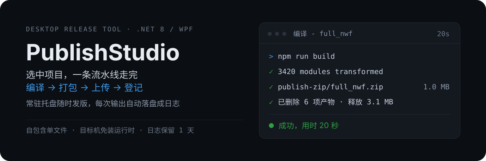

<p align="center">
  
</p>

# PublishStudio 发布工具

[](./LICENSE)  

一个常驻托盘的 Windows 桌面工具，把 .NET WebAPI / Node.js 项目的**编译、打包、上传 OSS、登记内务府发布记录**串成一条固定流水线。选中项目点一次，剩下的它跑完。

`Windows 10 / 11` · `.NET 8` · `WPF`

> **仓库地址还是占位符**：把下面  换成你的 GitHub 用户名后再提交。

```bash
git clone https://github.com/XCHLX/PublishStudio.git
cd PublishStudio
```

---

## 为什么用它

手工发一次版的顺序是：`dotnet publish` → 找到产物 → 压 zip → 打开浏览器传 OSS → 去内务府填发布记录。每一步都得记住参数和路径，顺序错了、漏了一步，包就已经放到服务器上了。

这个工具把顺序固定在代码里，**不可调整**，并在动手之前先把前置条件验完：

| 以前 | 现在 |
|---|---|
| 记命令、找产物目录 | 项目配置存一次，之后点一次 |
| 手动压缩、手动改名 | 自动按 `{目录名}-{时间戳}.zip` 命名 |
| 手动传 OSS、手填回调 | 自动上传 + 自动登记发布记录 |
| 出问题看不出卡在哪 | 日志窗口实时滚出每一步，同时落盘 |

## 快速开始

1. 运行 `PublishStudio.exe`（解压即用，不需要装 .NET）。
2. `Ctrl+N` 新建项目：选到含 `.csproj` / `package.json` 的那一层目录，类型选 `Api` 或 `Node.js`，填**内务府发布 ID**（发版才需要）。构建命令留空即用默认命令。
3. 菜单「设置 → 设置发布配置」填**接口地址 / 网页地址 / OSS Key / OSS 密钥**，再点右上角**登录**。
4. 选中项目右键「发布打包」。日志窗口会实时滚出编译、压缩、上传、回调的全过程。

只想在本地把项目跑起来调试，右键「运行」——它会在**系统控制台窗口**里执行 `dotnet watch run` / `npm run dev`，可以随手敲命令、`Ctrl+C` 停，关掉窗口进程就结束，不打包也不上传。

关闭主窗口不退出程序，只是缩到托盘；真正退出走托盘右键菜单。

## 一次「发布打包」做了什么

<p align="center">
  
</p>

1. **查发布信息** —— 按发布 ID 查一次，拿 IIS 站点名、服务器 IP、`isProduce`
2. **正式环境二次确认** —— `isProduce == true` 时弹「⚠️ 发布确认（危险操作）」，点「否」直接中止
3. **编译** —— `dotnet publish` 或项目自定义命令，输出到本次的产物目录
4. **压成 zip** —— 落到 `<产物目录>\publish-zip\{目录名}-{时间戳}.zip`
5. **后置命令** —— 项目自定义的那串命令，一行一条，任一条失败即中断
6. **上传 OSS** —— `NWF/Project/{IIS 站点名}/{Unix 时间戳}.zip`，bucket 由设置里的 OSS Key 对应账号决定
7. **回调内务府** —— `AddIisManagerItem` 登记发布记录（下载地址、发起人、目标服务器 IP）
8. **清理产物** —— 删掉编译产物只留 `publish-zip`，同目录下的历史包不动

缺任何一项前置条件（接口地址 / OSS 凭据 / 登录状态 / 发布 ID）都会在**编译开始前**报错，不会白跑一次编译。**本地 zip 会保留**，方便手工分发。

<details>
<summary>一次真实运行长什么样（「仅编译」的日志原文）</summary>

```text
[2026-11-17 13:52:25] 编译 - full_nwf
------------------------------------------------------------
工作目录: D:\Projects\demo-api
执行命令: npm run build
------------------------------------------------------------
> vue-vadmin-js@1.0.0 build
> vite build && node ./src/utils/cp.js
vite v5.0.11 building for production...
✓ 3420 modules transformed.
...
压缩进度: 100%
[完成] 已生成压缩包: ...\build\full_nwf-20261117-135225\publish-zip\full_nwf-20261117-135225.zip  (1.0 MB)
[清理] 已删除 6 项编译产物，释放 3.1 MB，保留 publish-zip
[完成] 编译结束
产物位置: ...\build\full_nwf-20261117-135225\publish-zip
------------------------------------------------------------
[2026-11-17 13:52:45] 成功，用时 20 秒
```
</details>

## 界面与操作

### 项目列表

| 操作 | 行为 |
|---|---|
| 双击项目 | 按「设置 → 设置发布配置 → 双击项目列表时触发」执行：`运行`（默认）/ `发布` / `编译` |
| 选中右键 | 运行、发布、编译、查询发布信息、打开发布记录页面、git pull、VS Code、打开目录、复制路径、编辑…、移除 |
| 「发布环境」列 | 读发布信息的 `isProduce`，显示**正式**（标红）/ **测试**；查不到按测试算 |
| 快捷键 | `Ctrl+N` 新建，`F5` 仅编译 |

新建或编辑项目保存后会自动查一次发布信息；想手工刷新就对项目右键「查询发布信息」。

同一个项目同时只允许一个任务，不同项目可以并行。

### 打开发布记录页面

右键「打开发布记录」在程序内嵌的 WebView2 窗口里打开当前项目的发布记录（纯网页，没有地址栏）。地址按这条规则拼：

```text
{网页地址}/?operate={登录账号}&redirect=/dmtools/WebManageDetail/{发布ID}?simple=1
```

- `网页地址` 取设置里的「网页地址」，结尾带不带 `/` 都行
- `登录账号` 取右上角登录的账号名，会做 URL 编码（账号可能含冒号与中文，不编码会拼出非法 URL）
- `发布ID` 取当前选中项目的「内务府发布 ID」

少任何一样都只提示、不打开坏页面：没选项目 / 没填发布 ID / 没配网页地址 / 没登录。标题栏会标 `（正式）` / `（测试）`，打开前静默刷新一次发布信息。

### 托盘

```text
托盘右键
├─ SCRM (2)                          ← 一级是自定义分组，标题颜色和列表色点一致
│   └─ full_nwf  · 正式 ▸  运行 / 发布 / 编译 / 查询发布信息 / 打开发布记录
│                          ──────────
│                          git pull / 用 VS Code 打开 / 打开目录 / 复制目录路径
│                          ──────────
│                          编辑… / 移除
├─ 工具 (1)
├─ 未分组 (3)                        ← 固定灰色、永远排最后
├─ ──────────
└─ 显示主窗口 / 最小化 / 退出
```

一级按**项目的自定义分组**排（`GroupName`，改项目对话框里的「分组」就能改），组名颜色按名字算，和列表的色点同一套规则、重启不变；组本身按拼音排，未分组的固定垫底。组内顺序跟随列表当前的排序列。

测试 / 正式的区分降到了项目名后面那截小字（` · 正式` / ` · 测试`，来自 `isProduce`）—— 三级菜单和列表右键菜单仍然**逐条一致**，执行的是同一批方法。托盘里点的是**那个项目本身**，不看列表当前选中项；「编辑」「移除」「打开发布记录」会先把主窗口唤出来，避免对话框跑到屏幕后面。正在跑任务的项目后面带 `(发布中)`。

## 项目类型与命令

| 类型 | 默认构建命令 | 产物目录留空时的推断值 |
|---|---|---|
| `Api` | `dotnet publish "<唯一的 csproj>" -c Release -r win-x64 --self-contained=true [-p:EnvironmentName=环境] -o "<临时目录>"` | `%TEMP%\PublishStudio\build\{目录名}-{时间戳}` |
| `Node.js` | `npm run build` | `<项目>\dist` |
| `Custom` | 无，必须自己填 | 无，必须自己填 |

新建项目时「产物目录」会**预填** `%TEMP%\PublishStudio\build\{folder}-{stamp}`，每个项目每次发布各落一个临时目录，包不会互相覆盖；清空这个框才回落到上表的推断值。

`.NET` 的产物目录直接传给 `dotnet publish -o`，填哪输出到哪。`Node.js` 的输出位置由项目自己的构建脚本决定，程序改不了 —— 所以填了「产物目录」时，会在构建成功后把 `dist` 的内容同步过去再打包，否则打出来是空包。

「产物目录」和「后置命令」都支持占位符：

| 占位符 | 含义 |
|---|---|
| `{work}` | 项目目录绝对路径 |
| `{output}` | 产物目录绝对路径（后置命令里用） |
| `{folder}` | 项目目录名 |
| `{stamp}` | 本次时间戳 `yyyyMMdd-HHmmss` |

默认按**自包含**发布（`-r win-x64 --self-contained=true`）：运行时一起打进产物，目标机**不用装 .NET**，直接跑 exe。代价是包大（几十 MB）、首次发布会联网拉一次 runtime pack、传 OSS 慢一些。

`--self-contained` 后面**必须带值**（默认命令用等号形式）：它是「空格分隔可选值」的参数，只写 `--self-contained` 的话 MSBuild 会把紧随其后的 `-p:EnvironmentName=xxx` 当成它的值，直接报 `MSB4030`。手写命令时同理。

想要框架依赖的小包（几 MB，服务器装一次 [Hosting Bundle](https://dotnet.microsoft.com/download/dotnet/8.0)），把这两个参数去掉：

```bash
dotnet publish -c Release -o "{output}"
```

## 环境、Node 版本与后置命令

下拉框选 `Development` / `Production` / `Staging` 时做两件事：给 `dotnet publish` 追加 `-p:EnvironmentName=xxx`；发布完成后把产物里的 `appsettings.{环境}.json` 复制成 `appsettings.json`，删掉其余 `appsettings.*.json`。找不到对应文件只记一条提示，不中断。

### 指定 Node 版本

不同项目常要求不同 node 版本。「编辑项目」里类型选 `Node.js` 时，「环境」那一格会变成 **Node 版本**：下拉列出 nvm 里装好的版本（读 `NVM_HOME`），也能手填 `18` / `18.20` / `18.20.8`。

构建和「运行」时，程序只把那个版本目录插到**子进程** PATH 的最前面，**不调用 `nvm use`** —— 不改系统的全局 node、不需要管理员权限、多个项目并行发布也不会互相踩。留空就用系统 PATH 里的 node。

版本填错（nvm 里没有）会在编译开始前报错，并列出实际装了哪些版本；没装 nvm 时下拉只有「（系统默认）」。全局装的 `pnpm` / `yarn` 不在版本目录里，指定版本后调不到，项目命令保持 `npm run build` 即可。

后置命令一行一条，按顺序在项目目录执行，`#` 开头和空行跳过：

```text
# 拷到内网共享
xcopy /E /I /Y "{output}\publish-zip" "\\192.168.1.10\deploy\%date%"
```

`copy` / `xcopy` / `rd` 这类 **cmd 内置命令**也能直接写 —— PATH 里找不到可执行文件时会自动交给 `cmd.exe /c`。子进程输出逐行自动识别编码：先按 UTF-8 严格解码，解不通再按系统 ANSI 代码页（中文 Windows 上是 GBK），所以 `dotnet` 的 UTF-8 和老工具的 GBK 都不会乱码。

## 数据与日志

| 内容 | 位置 |
|---|---|
| 项目清单 | `%LOCALAPPDATA%\PublishStudio\projects.json` |
| 发布配置（含 OSS 凭据、登录账号） | `%LOCALAPPDATA%\PublishStudio\settings.json` |
| WebView2 缓存 | `%LOCALAPPDATA%\PublishStudio\WebView2` |
| 编译临时产物 | `%TEMP%\PublishStudio\build\{目录名}-{时间戳}` |
| 压缩包 | `<产物目录>\publish-zip\{目录名}-{时间戳}.zip` |
| 运行日志 | `%TEMP%\PublishStudio\Logs\{日期}_{时间}_{项目}_{动作}_{结果}.log` |

日志窗口滚出来的每一行都同时落盘，全部平铺在 `Logs` 下。运行期间叫 `_运行中.log`，结束时按结果改成 `_成功` 或 `_失败`（取消也算失败）。**所有日志一律只保留 1 天**，超期的在程序启动时删掉。临时目录不可写时不会影响任务，界面上照样看得到。

`build\` 下的历史目录不会无限堆积：「保留历史发布文件」可选 `不保留` / 1 / 3 / 7 / 15 / 30 天（默认 3 天），超期的在**程序启动时**和**每次发布成功后**自动删。选「不保留」只留最近 1 小时内创建的目录（刚发的包还在，别的项目正在编译的目录也不会被误删）。

`projects.json` 是普通 JSON，可以直接手改；改坏了程序会备份成 `.broken` 再空着启动，不会打不开。

> **注意**：`settings.json` 里的 OSS 密钥是**明文**。这台机器谁能读到这个文件，谁就能拿到发版权限。

菜单「帮助」里还有：打开配置文件夹、打开临时文件夹、打开日志文件夹、关于（版本 / 作者 / 运行环境 / 目录一览，带「复制信息」按钮）。

## 下载与安装

每个版本的 [Releases 页面](https://github.com/XCHLX/PublishStudio/releases) 提供三个包，按你的场景选一个：

| 包 | 适合谁 | 怎么用 | 前提 |
|---|---|---|---|
| `PublishStudio-<版本>-win-x64.zip` | 大多数人 | 解压，双击 `PublishStudio.exe` | 无，免装 .NET（约 60 MB） |
| `PublishStudio-<版本>-win-x64-fd.zip` | 在意体积 | 解压，双击 `PublishStudio.exe` | 需装 [.NET 8 Desktop Runtime](https://dotnet.microsoft.com/download/dotnet/8.0)（约 2 MB） |
| `PublishStudio-<版本>-setup.exe` | 想要开始菜单和卸载项 | 双击安装，一路下一步 | 无，内部自带运行时 |

三个包里都带同一份 `使用说明.txt`，开篇先让你认领是哪一种包，再分别讲自包含版、依赖环境版、安装版的运行步骤——所以三种包只需要维护这一个说明文件。

- **依赖环境版（`fd`）** 必须先装 .NET 8 **Desktop** Runtime（不是 Runtime、也不是 SDK），并且 `WebView2Loader.dll` 要和 exe 放在一起，删了「打开发布记录」会打不开。
- **安装版** 默认装到 `C:\Program Files\PublishStudio`（要 UAC 提权），建开始菜单组、桌面快捷方式和卸载项；升级直接跑新版 `setup.exe` 覆盖安装，`AppId` 相同会识别成升级，配置不丢。

三种包都要求系统有 WebView2 Runtime：Win11 自带，Win10 没装时「打开发布记录」窗口会提示安装。系统要求 64 位 Windows 10 / 11。

第一次运行若弹「Windows 已保护你的电脑」，点「更多信息 → 仍要运行」——exe 和 `setup.exe` 都没有代码签名，这是正常提示。

## 本地打包

一条命令出包，版本号默认从 `csproj` 读：

```powershell
powershell -ExecutionPolicy Bypass -File .\build-release.ps1              # 只出自包含版
powershell -ExecutionPolicy Bypass -File .\build-release.ps1 -Flavor All # 自包含 + 框架依赖，两个 zip
powershell -ExecutionPolicy Bypass -File .\build-release.ps1 -Version 0.05
powershell -ExecutionPolicy Bypass -File .\build-release.ps1 -NoZip      # 只出 dist，不压缩
```

产物：

| 路径 | 说明 |
|---|---|
| `dist\PublishStudio.exe` | 自包含单文件 |
| `dist-fd\PublishStudio.exe` + `WebView2Loader.dll` | 框架依赖版 |
| `release\*.zip` | 可直接分发的压缩包 |

要把自包含版做成安装包，本机装了 Inno Setup 6 后执行：

```powershell
& "${env:ProgramFiles(x86)}\Inno Setup 6\ISCC.exe" /DMyAppVersion=0.04 deploy\PublishStudio.iss
```

单文件 / 自包含参数**没有写进 csproj**：写进去会让日常 `dotnet build` 和 F5 调试也变成 RID 专用构建、还得先有 runtime pack。参数只在发布时由脚本传。

## 发版（维护 Release）

版本维护靠 **tag**，不用在 GitHub 网页上手点上传。流程固定为四步：

**1. 改版本号**：`PublishStudio.csproj` 里三行一起改，保持对应：

| 字段 | 示例 | 用途 |
|---|---|---|
| `<Version>` | `0.4.0` | 必须规范三段式，tag 和文件名用它 |
| `<FileVersion>` | `0.4.0.0` | Windows 文件版本，四段式 |
| `<InformationalVersion>` | `0.04` | 「帮助 → 关于」里显示的 `V0.04` |

**2. 提交并打 tag**：tag 名必须是 `v` + 三段式版本号（如 `v0.4.0`），工作流会校验格式。

```bash
git add .
git commit -m "chore: release v0.4.0"
git tag v0.4.0
git push origin main
git push origin v0.4.0
```

**3. 自动构建**：push tag 触发 `.github/workflows/release.yml`，它依次做：

- 检出代码、装 .NET 8 SDK、从 tag 解析版本号
- 跑 `build-release.ps1 -Flavor All` 出两个 zip
- 用构建机预装的 Inno Setup 编译 `setup.exe`
- 创建 Release，上传三个包，自动生成更新说明

进度在仓库的 **Actions** 页看。失败通常是 tag 格式不对或 Inno Setup 没预装，日志里会写明。

**4. 核对**：到 Releases 页确认三个附件都在、版本号对，再下载一个 zip 解压试跑。

改了内容但不想发版（比如补文档），只 commit 和 push，不要打 tag。一个 tag 对应一个 Release，重复 push 同一个 tag 不会覆盖旧 Release——要重发就删掉旧 tag 和 Release，改用新版本号（如 `v0.4.1`）。

## 代码结构

```text
Core/     AppStore 配置读写      Publisher 流水线        ProcessRunner 进程与压缩
          OssUploader 上传       NwfApi 内务府接口       BuildHistory 历史目录清理
          LogFile 日志落盘       TrayManager 托盘        AppIcon 运行时画图标
Models/   Project / PublishSettings / NwfRelease
Views/    MainWindow  ProjectDialog  SettingsDialog  LogWindow
          LoginWindow  WebPageWindow  AboutWindow
Styles/   Theme.xaml（按钮、输入框、滚动条等隐式样式）
```

第三方依赖只有两个：`Aliyun.OSS.SDK.NetCore`（传 OSS）、`Microsoft.Web.WebView2`（内嵌发布记录页）。其余全是 BCL。托盘用 `System.Windows.Forms.NotifyIcon`，只引用了这一个 WinForms 类型。

## 踩过的坑

- **`E:\global.json` 把整个 E 盘锁在 SDK 3.1.426**：本项目 `global.json` 钉了 `8.0.419`（子目录优先于上层），否则在 E 盘编译 net8.0 会报 `MSB3971`。
- **`npm` / `yarn` / `pnpm` 在 Windows 上是 `.cmd`**：直接 `Process.Start("npm")` 报找不到文件，`ProcessRunner` 会先查 PATH 解析成 `npm.cmd` 的绝对路径。
- **stdout 和 stderr 必须同时异步读**：只读一边，另一条流缓冲区（约 4KB）满了子进程就卡死，表现是「发布停在某一行不动」。
- **压缩时 zip 落在源目录内部时要把整个 zip 目录排除**，否则旧包被递归打进去，包体逐次翻倍。
- **`UseWindowsForms` 会注入一条 `global using System.Windows.Forms`**，导致 `Application` / `MessageBox` 和 WPF 同名类型撞车，csproj 里已把那条全局导入和 `System.Drawing` 一起去掉，只有 `TrayManager.cs` 显式 using。
- **托盘图标是运行时用 `System.Drawing` 画的**（`Core/AppIcon.cs`），不依赖外部 `.ico`；`app.ico` 只给 exe 当图标。
